# The Hidden Critical Path: An Incremental Analysis of Container Image Pull Bottlenecks in containerd

[Omer Oz](mailto:to@OmerOz.fyi), Oct 2026, v.1

## Abstract

Container image pulls sit on the critical path of cold pod startup, delaying service scale-out and the launch of pretraining, post-training, evaluation, and data-processing jobs. Larger images, denser hosts, and the distribution of model checkpoints through Kubernetes image volumes increase both the work per pull and demand on the node's shared pull pipeline. Pull systems designed for earlier hardware and workloads retain defaults and processing paths that prolong startup even when fast networks, NVMe storage, and CPU cores are available. We trace and measure the full pull path in containerd 2.4, progressively removing registry and storage bottlenecks to expose runtime limits in a fast-cluster regime. A 9.40 GB PyTorch image takes 266.7 s to pull on an EC2 instance with baseline gp3 storage and generates 26.50 GB of disk writes. Faster compute, NVMe-backed storage, and high-bandwidth image delivery, combined with zstd and parallel unpacking, reduce the pull to 29.8 s, an 8.95× improvement. On the same faster hardware, the codec and unpacking changes alone reduce 88.5 s to 29.8 s, a 2.97× speedup. Native EROFS layers avoid eager tar extraction and reduce the pull to 15.3 s, a 17.43× improvement over the cloud baseline. Further isolation reveals fs-verity checks that serialize layer commits across containerd; a patched build allows those checks to overlap and shortens download duration. Ordered per-layer verification and extraction remain limits on CPU parallelism. Synthetic parallel extraction reaches 110 Gbps when work is spread across enough layers. These results identify opportunities to reduce cold-start latency within the native pull path, before adding prewarming services, specialized image-loading stacks, or remote-storage dependencies.

## 1. Introduction

A scheduled workload cannot begin execution until its container image is available on the node. On a cold node, the runtime must fetch the image, verify its contents, decompress its layers, and construct its filesystem. We use *container image pull* for this complete download-and-unpack path. Its latency delays service scale-out, replacement workers after a failure, and jobs scheduled onto newly provisioned capacity. For GPU workloads, allocated accelerators can remain idle while their software environments are pulled.

Kubernetes supports a growing ecosystem of machine-learning training, workflow, and serving systems. Kubeflow Trainer orchestrates distributed training and fine-tuning jobs [8], while Kubeflow Pipelines runs container-based ML workflows on Kubernetes [9]. KServe supports a Knative-based serving mode with request-driven scaling and scale-to-zero [10]. Its documentation identifies pulling an uncached serving image as an additional cold-start cost. Across these systems, image-pull latency affects how quickly scheduled workers and serving replicas become usable.

Larger images, larger hosts running more pods, and a wider range of OCI-distributed artifacts increase pressure on the pull pipeline. During a rollout or node replacement, more pods can mean more images to pull through the same runtime, network, and storage. Kubernetes image volumes also allow OCI artifacts to be mounted into pods, extending the delivery path beyond application environments to model weights and checkpoints. These artifacts add to the data that must become available before a workload can run.

Machine-learning environments illustrate the image-size problem. Frameworks, CUDA libraries, compilers, and supporting tools produce multi-gigabyte images before model weights are included. The PyTorch development image studied here is 9.40 GB compressed and 16.93 GB unpacked. Agentic training adds repeated provisioning of execution environments to the training loop [5], while evaluation and data-processing jobs require environments on whichever workers receive their tasks. New nodes and cache eviction repeatedly expose the cost of cold pulls.

NVIDIA's DGX B300 reference system provides 6,400 Gbps of aggregate compute-network bandwidth and 800 Gbps of aggregate storage-network bandwidth [6]. Its eight NVMe data drives offer an estimated 216–440 Gbps of aggregate sequential reads in a striped Gen4 configuration. These figures describe separate resources: the storage network is the relevant reference for image delivery, while the compute fabric serves accelerator communication. The network figures are line rates, and the disk estimate comes from the accompanying host notes.

Container image-pull systems were designed for a different generation of hardware and workloads. Their assumptions about image size, host capacity, concurrency, and acceptable startup latency no longer match the demands of large images, dense nodes, and rapidly provisioned jobs. This mismatch appears in defaults and processing paths that remain startup bottlenecks on faster hardware. The kubelet serializes image pulls by default, allowing a large image to delay unrelated pods waiting for their own images [7]. In the containerd transfer service studied here, the default limit of three concurrent layer downloads is shared across all pulls handled by the daemon. Containerd also unpacks each image's layers sequentially by default, while verification and decompression impose per-layer limits.

Options for parallel pulls and unpacking exist, but their configuration, scope, and prerequisites are scattered across Kubernetes and containerd documentation. The explanation of the pull path is similarly fragmented: understanding how downloading, verification, content commits, and unpacking interact requires piecing together documentation, runtime source code, and traces. An operator must identify both the limiting stage and the scope of its concurrency controls to make effective use of the available hardware.

Slow image pulls consume time from resources that have already been allocated. Distributed pretraining amplifies the effect: coordinated execution must wait for the required workers, so a cold-pull straggler can leave otherwise-ready GPU workers idle. Image-pull tail latency therefore affects the whole job, beyond the startup of the individual pod.

The same dependency appears in post-training pipelines. Rollout generation and evaluation require execution environments to become ready, and a synchronous pipeline waits when a required stage cannot supply its results. Those environments need not themselves run on GPUs: delayed CPU-based sandboxes can reduce the rate at which a training system receives completed interactions. Autoscaling, node replacement, and job recovery repeatedly expose these costs when images are absent from the selected nodes. Image pulls can consequently delay both the launch of a GPU job and the work needed to keep it progressing.

Production measurements put this startup cost in concrete terms. BootSeer reports over 4,700 GPU-hours lost in one day to image loading, environment setup, and model initialization at a production training cluster [11]. The study describes workers waiting for the slowest image pull before synchronizing, directly connecting node-level pull latency to job-wide delay. Its image-loading stage takes 20–40 s even with block-level lazy loading, while environment setup and model initialization account for larger portions of startup.

The resource cost scales with the allocation held idle and the duration of the delay. For an allocation of *G* GPUs held for *t* seconds before useful execution, the startup cost is *G × t / 3,600* GPU-hours. At fleet scale, repeated minutes of delay accumulate into substantial lost GPU time. Our measurements connect the pull's internal operations and concurrency limits to that delay, then show how its critical path changes as bottlenecks are removed.

Production systems already spend infrastructure effort avoiding this delay. In its 2018 Docker-based deployment, OpenAI reported that a 17.00 GB Dota image could take 30 minutes to pull on a fresh worker, with kubelet-serialized pulls also blocking unrelated pods [4]. Alongside faster storage and concurrency changes, they preloaded commonly used images into worker machine images. This is effective when a known set of environments is reused; it moves preparation ahead of demand rather than eliminating it.

Diverse agent workloads make that assumption harder to sustain. DeepSeek's 2026 DSec report describes more than 129,996 GB of image artifacts active in one production week and a median container-image fanout of three [5, §4.4]. DSec converts OCI container images to EROFS, keeps filesystem metadata locally, and reads file data on demand from the shared 3FS filesystem. Its storage servers have dual 400 Gbps RDMA NICs; CPU workers access 3FS through its FUSE client [5, §§3.3, 7]. In its 8,192-container evaluation, on-demand loading reduced workload completion time from over 60 minutes to about 35 minutes [5, §8.2].

These production choices show that the default eager-pull experience has been insufficient for demanding workloads. OpenAI moved image pulls ahead of demand; DeepSeek replaced full-image download and extraction with on-demand reads. Operators have addressed startup requirements by building around the conventional pull path. This motivates examining the eager-pull path that containerd provides today and how far existing settings and image formats can improve it.

Building around that path adds operational cost. Prewarming jobs, image-conversion pipelines, specialized snapshotters, cache services, and remote filesystems each bring configuration, upgrades, monitoring, and failure modes that platform teams must integrate and maintain. Remote-storage-backed loading also puts the storage service on the execution path for uncached reads. Fast image access becomes a property of a bespoke infrastructure stack rather than an out-of-the-box runtime capability.

For containerd deployments, this shifts responsibility for overcoming runtime limits onto the surrounding platform. Improving the native pull path addresses both performance and simplicity: operators should not need additional infrastructure merely to use the network, storage, and CPU capacity their nodes already provide. On-demand loading retains an independent advantage for workloads that read only a fraction of an image, because it avoids fetching and extracting unused data. We examine the avoidable eager-pull overhead that makes additional delivery infrastructure necessary even when local storage and network capacity are ample.

A full pull does more than transfer the image's compressed size. In our cloud experiment, containerd receives a 9.40 GB image and writes 26.50 GB: the compressed layers go into its content store, then their extracted contents go into filesystem snapshots. The last network byte arrives at 90.9 s, but the pull completes at 266.7 s. Treating this as a network-transfer problem misses almost three minutes after the transfer has ended. Conversely, on a faster local machine, gzip decompression and sequential extraction dominate even though the disk and registry can deliver data much faster.

We analyze this critical path incrementally, identifying the limiting resource, removing its constraint, and measuring what becomes limiting next. Full pulls of a public PyTorch image establish the end-to-end cost. Unpack-only measurements of an NVIDIA driver image and synthetic images with controlled layer layouts isolate individual mechanisms. CPU profiles, system-call traces, and runtime source inspection explain where the time goes.

The progression from a 266.7 s cloud baseline to faster infrastructure, zstd, and parallel unpacking reaches a 29.8 s pull, an 8.95× improvement. On the same faster hardware, the codec and unpacking changes reduce 88.5 s to 29.8 s, a 2.97× speedup. Native EROFS layers avoid tar extraction and bring the pull to 15.3 s. Once registry and storage constraints are removed, fs-verity checks serialize layer commits across containerd, while ordered per-layer verification and extraction restrict CPU parallelism. A patched build overlaps fs-verity work and shortens synthetic download duration. Together, these results connect the latency of a full pull to its internal bottlenecks and identify improvements within the standard OCI image and containerd pull path.

## 2. Experimental Design

We use two environments for different questions. The cloud instance shows the combined cost of a public-registry pull on baseline storage. The local machine supplies enough CPU, memory, and registry bandwidth to expose runtime costs that the cloud environment hides. The local testbed exposes runtime bottlenecks that slower infrastructure can hide. The local container registry and nvme disks provide high-bandwidth transfers and storage.

| Property                           | Cloud VM                 | Local testbed                                          |
| ---------------------------------- | ------------------------ | ------------------------------------------------------ |
| Host                               | EC2 m7i-flex.large       | OrbStack Linux VM on Apple M4 Pro                      |
| CPU                                | 2 vCPU, x86-64           | 13 cores, arm64                                        |
| Memory                             | 7.62 GB                  | 48.00 GB                                               |
| Operating system                   | Ubuntu 24.04             | Ubuntu 26.04, Linux 7.2                                |
| containerd                         | 2.4.1                    | 2.4.2                                                  |
| Container Registry                 | Docker Hub               | Local                                                  |
| Runtime storage                    | gp3                      | NVME                                                   |
| Sequential disk write throughput   | 1.1 Gbps                 | 19.6 Gbps                                              |
| Network speed                      | 3 Gbps                   | 100 Gbps                                               |

*Table 1. Test environments. The EC2 VM represents a regular cloud instance with slower storage and networking, while the local M4 Pro testbed approximates a cluster of machines with fast storage and high-bandwidth networking.*

We use two public images and a locally built 1.61 GB synthetic image in our tests.

| Full image name | Layers | Compressed size | Decompressed size |
|---|---:|---:|---:|
| `pytorch/pytorch:2.8.0-cuda12.8-cudnn9-devel` | 15 | 9.40 GB gzip; 7.99 GB zstd; 12.13 GB L4Z | 16.99 GB |
| `nvidia/driver:460.73.01-ubuntu20.04` | 16 | 343.5 MB gzip; 327.9 MB zstd | 680.3 MB |
| `ctx-rand3` | 3 | 1.61 GB (gzip) | 1.61 GB |

*Table 2. Experimental container images.*

For full pulls, we clear the destination content store and snapshots before each measurement. The local registry is already populated, with its blobs in the page cache. For unpack-only measurements, we download the blobs first, then time a subsequent pull that extracts the missing snapshots.

Wall-clock command timings measure full pulls. Runtime logs identify extraction and image-unpack durations. CPU profiles attribute user-space work; traces identify synchronization and fs-verity calls. Network counters measure transfer windows, while containerd's process I/O counters distinguish its physical writes from unrelated host activity. Traced runs are used to explain operations, not as uninstrumented performance baselines.

## 3. A Practical Model of an Image Pull

A container image is an ordered set of layers, usually stored in a registry as compressed tar archives. Pulling an image turns those archives into the files a container can use. The work has two main phases: downloading the layers and unpacking them.

**Download.** Containerd fetches each layer from the registry, verifies its contents as the bytes arrive, and writes the compressed archive to its content store on the node. Before the layer becomes available for unpacking, containerd flushes and commits it. On supported filesystems, this also includes fs-verity integrity checks.

**Unpack.** Containerd reads the stored archive, decompresses it, verifies the uncompressed contents, and extracts its files into a filesystem snapshot. The snapshots form the layers of the container's filesystem. Once an image is available locally, containers can share these snapshots without repeating the pull.

The phases overlap across layers. A layer can start unpacking once its download and commit finish, while other layers are still arriving. The pull completes when all required layers have been downloaded and unpacked.

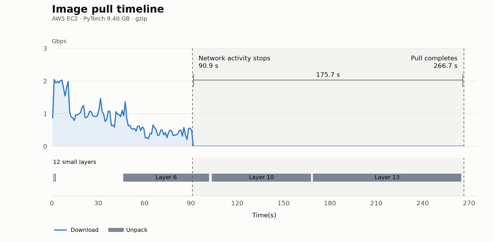

*Figure 1. Network throughput and layer extraction during the AWS PyTorch pull. The pull continues long after network transfer ends.*

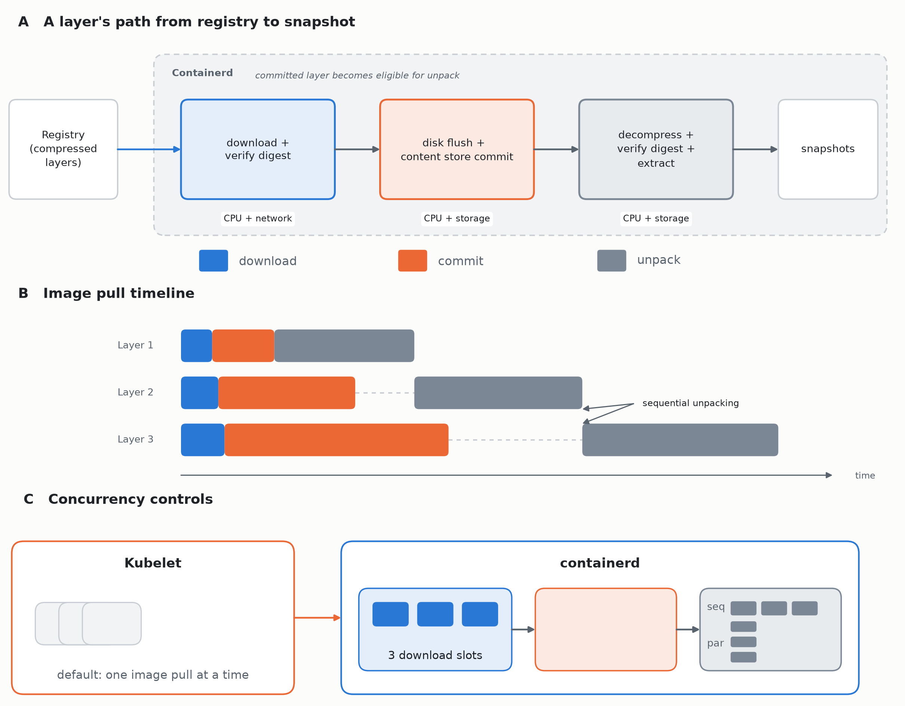

*Figure 2. Container image pull pipeline and default concurrency controls.*   
*(A) Each layer is downloaded and verified, flushed and committed to the content store, then unpacked into a snapshot.*  
*(B) Downloads and flushes overlap, unpacking is sequential by default.*  
*(C) The kubelet requests one image pull at a time; containerd shares three layer-download slots across pulls and unpacks each image sequentially.*

### 3.1 The bottlenecks of the image pull

The download uses network for transfer, CPU for verification, and storage for the compressed layers. Unpacking uses CPU for decompression and verification, and storage for snapshots. Image pull time depends on which of these resources, or which concurrency limit, holds up the work needed to finish.

On a node with slow storage, writing the downloaded and extracted data can dominate. Faster storage can expose decompression as the next bottleneck. A faster codec can then make sequential unpacking the larger cost. Once layers unpack in parallel, the layer that takes longest to finish can determine when the whole image becomes usable. Improving one stage therefore changes where to look next; a faster network alone cannot eliminate time spent unpacking after the last byte arrives.

Layer layout matters because much of the work is parallelized between layers. An image with many layers can still have little useful parallelism if almost all its bytes sit in two or three of them. More download or unpack slots will not divide one large layer's ordered verification and extraction stream among more cores.

### 3.2 Concurrency has more than one scope

Kubernetes and containerd control different parts of the pipeline. By default, the kubelet requests one image pull at a time on a node [7]. Other pods needing images wait behind it. Setting `serializeImagePulls: false` allows pulls for different pods to proceed concurrently, and `maxParallelImagePulls` can bound their number. Inside the containerd transfer service studied here, the default three-download limit is shared across all image pulls handled by the containerd daemon. Each image's layers also unpack sequentially by default.

The practical question is not simply how many image pulls are running, but what work they can perform concurrently and which resource they share.

## 4. Unpacking Bottlenecks

Storage must absorb both downloaded archives and extracted files. We first examine this disk bottleneck, then use faster infrastructure to expose decompression and extraction costs. We replace gzip with zstd, parallelize layer extraction, and use tmpfs experiments to identify the remaining CPU and filesystem costs. Finally, we examine native EROFS layers, which avoid tar extraction altogether.

### 4.1 The disk bottleneck

The cloud pull in Figure 1 illustrates these dependencies. Pulling the 9.40 GB PyTorch image from Docker Hub takes 266.7 s on the EC2 instance. Layers download concurrently and can finish out of order, but unpacking follows their order in the image. Downloading and unpacking overlap when the next layer needed for extraction is available while other layers are still downloading. Disk bandwidth is the bottleneck: the volume provides 1.1 Gbps, and the node must write both compressed blobs and extracted files.

The compressed image size describes what crosses the network, not all the work the node performs. Containerd first stores the compressed archives, then writes their extracted contents into snapshots. It also reads the archives back during unpacking, often from the page cache.

For the PyTorch image studied here, 9.40 GB arrives from the registry and 16.93 GB is extracted. Together, the stored archives and snapshots occupy 26.33 GB. The cloud pull produces 26.50 GB of disk writes, or roughly 2.8 bytes written for every byte received. For this image, keeping storage writes moving at the rate of incoming data requires about 2.8 times the compressed-input bandwidth. The ratio changes with the image's compression and contents.

This explains why a node can have spare network capacity and still pull slowly: the storage must absorb both forms of the image. The runtime synchronizes downloaded archives before committing them, while extracted files can remain buffered when the pull returns. The measured completion time follows that runtime behavior.

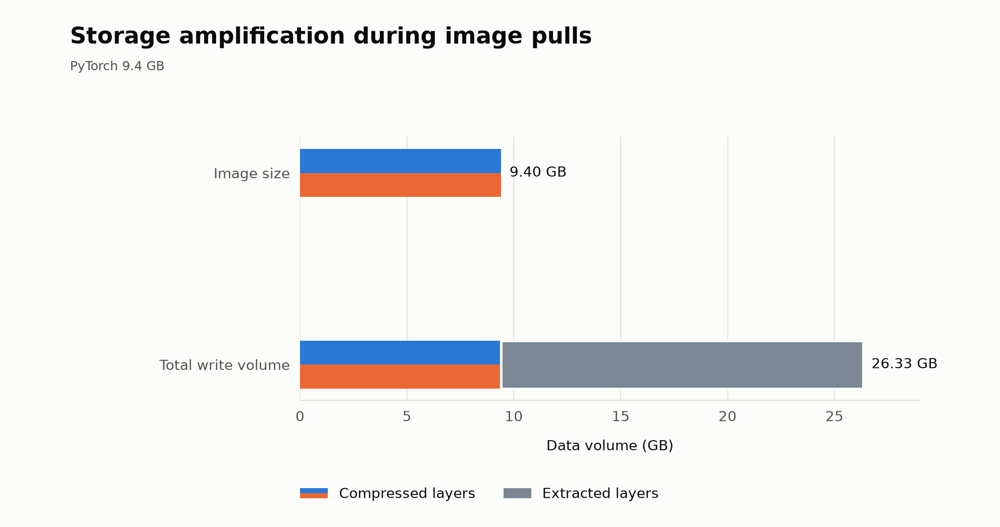

*Figure 3. Containerd stores both compressed and extracted layers and produces disk writes totaling 2.8× the image size.*

Moving to the local testbed reduces the gzip pull from 266.7 to 88.5 s, a 3.01× speedup with the codec and sequential unpack schedule unchanged. This transition changes compute and image delivery as well as storage, so the improvement cannot be attributed to disk bandwidth alone. The local disk provides 19.6 Gbps of sequential write throughput, compared with 1.1 Gbps on the cloud instance. Faster infrastructure exposes decompression and sequential extraction as the next limits.

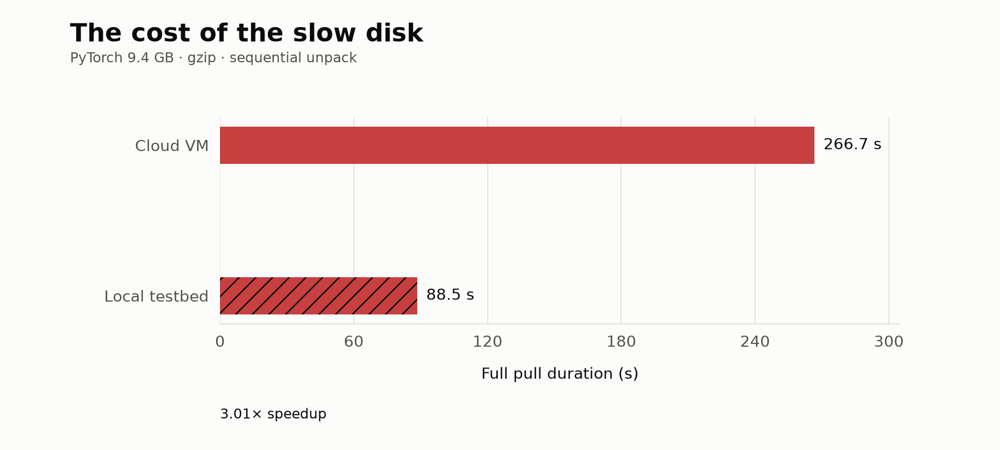

*Figure 4. PyTorch full pulls with gzip and sequential unpacking on the cloud VM and local testbed.*

### 4.2 The dominant cost in unpacking: gzip

Gzip dates to the early 1990s, yet it remains the compression format used by both public images studied here. On the fast local testbed, decompression keeps the PyTorch pull running long after downloading ends. Faster networking and storage leave this CPU work unchanged. Replacing gzip with zstd shortens the pull without changing the hardware or sequential unpack schedule.

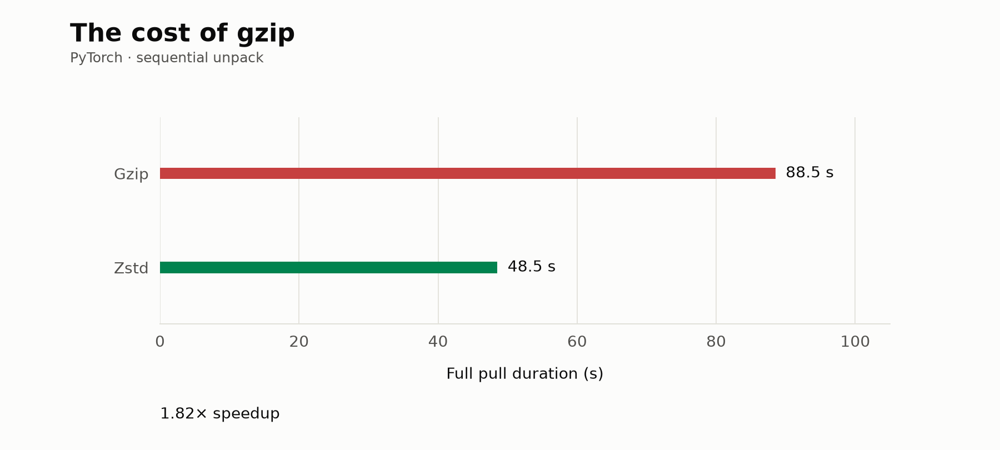

*Figure 5. Gzip vs zstd pull durations.*

A faster codec reduces each layer's processing time, but the layers still wait for one another under sequential unpacking. We next remove that inter-layer waiting.

### 4.3 Accelerating unpack through parallelism

Containerd normally extracts an image's layers sequentially. Parallel unpack extracts layers into independent snapshots, then establishes their ordered relationship using the snapshotter's rebase capability. Extraction overlaps while final ordering remains sequential. For the PyTorch image with zstd, the dominant layers can now make progress together rather than waiting for each preceding layer to finish.

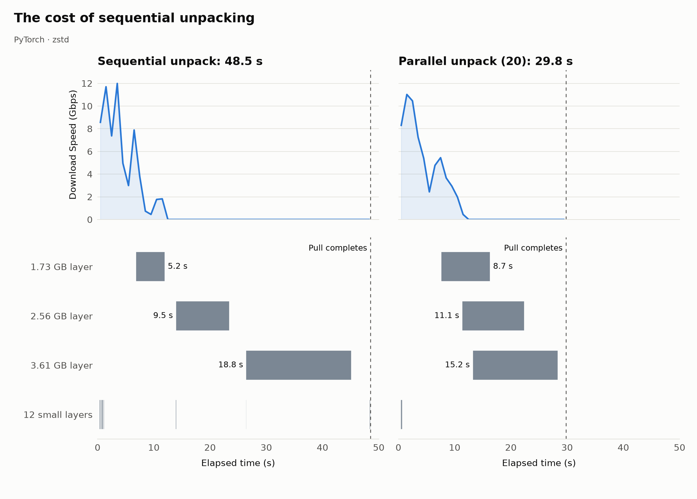

*Figure 6. Parallel unpack overlaps the three dominant layers and reduces the zstd pull from 48.5 to 29.8 s.*

The PyTorch image concentrates nearly all its data in a few large layers. Once the smaller layers finish, the largest continues alone, leaving much of the machine idle. Parallel unpack removes waiting between layers, but its effectiveness still depends on how evenly the image distributes work.

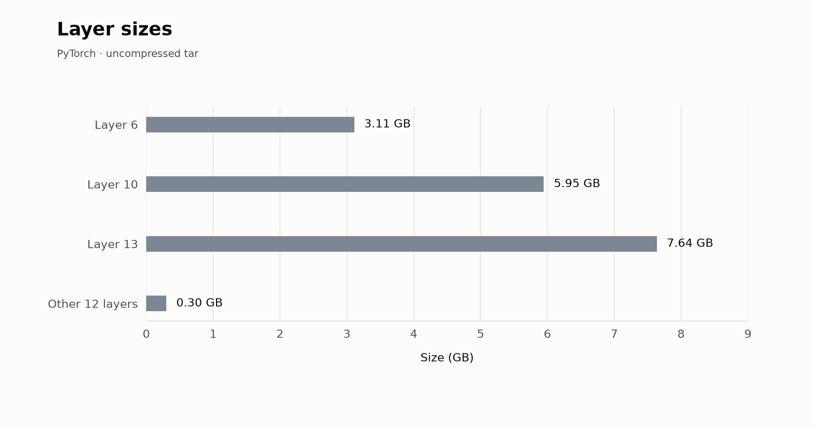

*Figure 7. Three layers contain approximately 98% of the PyTorch image's uncompressed tar data.*

### 4.4 Removing the disk from the picture

Parallel unpack overlaps layers, but each layer still has to be decompressed, verified, and extracted. To isolate these costs, we predownload the NVIDIA driver image's blobs and measure sequential unpacking with containerd's content store and snapshots on tmpfs.

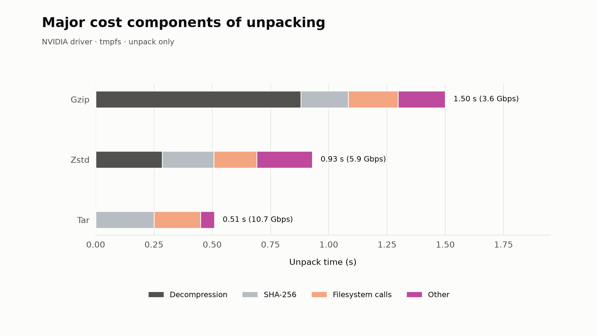

*Figure 8. NVIDIA driver unpacking on tmpfs. Bar totals show measured unpack time; component widths are estimated from CPU-profile shares. Other includes memory copying. Zstd reduces decompression cost; verification and file creation remain.*

Faster decompression exposes verification and file creation as the remaining costs. Even plain tar must pass through the uncompressed digest, data copying, and per-file filesystem operations. These steps keep unpacking CPU-bound after both compression and physical storage are removed.

### 4.5 The next unpacking bottleneck: SHA-256 verification

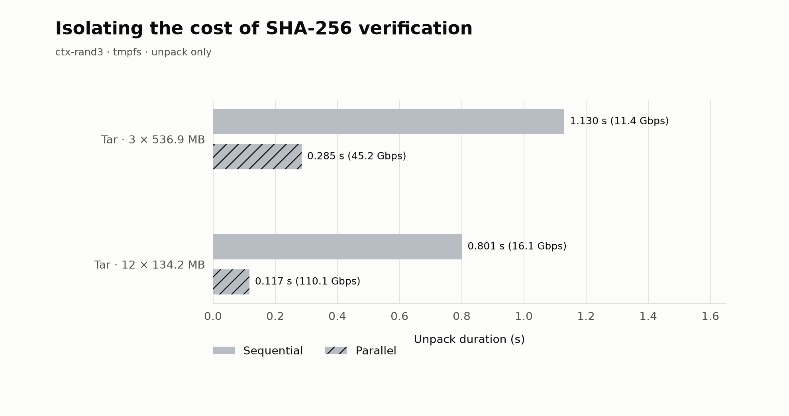

*Figure 9. Sequential and parallel unpacking of 1.61 GB of synthetic data on tmpfs. Twelve smaller layers expose more parallelism than three larger layers. Bars show the maximum duration across four runs per configuration.*

To isolate SHA-256 verification cost we move to our synthetic `ctx-rand3` image family. These synthetic images contain one random file at each layer. The total data stays fixed at 1.61 GB and we split the image across either three 536.9 MB or twelve 134.2 MB layers. By decreasing the number of files from tens of thousands to single digits we remove the filesystem cost. We also remove decompression costs by using plain tar images.

Spreading the same data across more layers lets more cores participate and shortens unpacking. Each layer still has an ordered processing stream; the extra parallelism comes from running more independent streams, not from accelerating a single layer.

### 4.5 Avoiding tar extraction with native EROFS layers

The previous experiments accelerate the conversion of tar archives into files. Native EROFS layers avoid that conversion: each layer is already a filesystem image. The EROFS differ and snapshotter prepare it without extracting tars. No need for decompression or sha-256 or tar extraction. individual files, and the kernel decompresses its internal LZ4 data as files are read. On the testbed's btrfs filesystem, reflinks also let the snapshotter reuse the blob's data without copying it. We use the same PyTorch image converted into EROFS layers, totaling 12.15 GB.

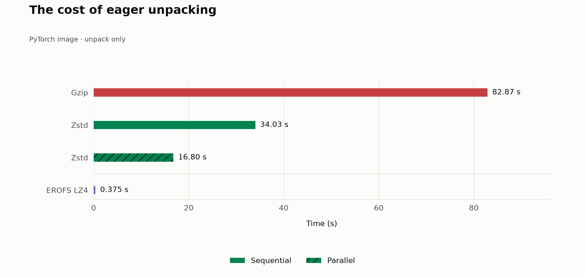

*Figure 10. PyTorch image unpack comparison.*

## 5. Download Speed: From Registry Limits to Runtime Limits

We isolate the download path with `nerdctl pull --unpack=false`, which fetches, verifies, and stores image layers without extracting their files. Throughout this section, *transfer time* is the active network-receive window; *download duration* is the command's elapsed time, including verification and content-store commits. We begin with the PyTorch image on the cloud instance, comparing one concurrent layer download with the default three (Table 3).

| Concurrent layer downloads | Mean transfer rate (Gbps) | Peak rate (Gbps) | Download duration (9.40 GB) |
| -------------------------- | ------------------------: | ---------------: | ------------------------: |
| 1                          | 0.66                      | 1.1              | 120.9 s                   |
| 3 (default)                | 1.0                       | 2.8              | 79.4 s                    |

*Table 3. PyTorch downloads without unpacking from Docker Hub on the cloud instance. Mean rates cover active transfer; peaks use 0.5 s samples.*

One stream averages 0.66 Gbps and peaks at 1.1 Gbps, leaving much of the node's 3 Gbps network capacity unused. Three streams reach a combined peak of 2.8 Gbps and reduce download duration from 120.9 to 79.4 s, a 34% reduction. The gain from concurrent streams indicates a per-connection constraint on the blob-delivery path.

In the measured configuration, containerd fetches each layer through one HTTP/1.1 request over a single TCP connection. Two external constraints determine the rate available to that connection:

1. **The source.** Registries commonly serve layer blobs from object storage or a CDN. Source-side disk-read throughput, cache misses, competing requests, and service throttling can limit how quickly bytes are served. The capacity available to one connection can therefore be much lower than the service's aggregate bandwidth.
2. **The network path.** Link bandwidth, round-trip time, and TCP configuration determine how much of the source's capacity a connection can use.

The registry API and the layer source are often different services. Amazon ECR, for example, provides image manifests through ECR but stores layer blobs in Amazon S3, which clients access to download them [12]. Our Docker Hub cloud experiment likewise receives layers from S3 addresses in the same AWS region. A pull's transfer rate therefore depends on the blob-delivery path, not just the registry endpoint. Containerd adds its own work at the destination: hashing each incoming byte, writing the archive, and committing it to the content store.

Concurrent layer downloads combine the throughput of several connections. The transfer service provides three shared download slots by default, but an image dominated by one large layer can leave only one slot doing useful work near the end. Enabling `concurrent_layer_fetch_buffer` splits a layer into parallel range requests, allowing even a single large layer to use several connections. Downloading different layers concurrently can also let smaller, earlier layers finish soon enough for unpacking to overlap with the remaining downloads. Neither form of concurrency removes the verification and storage work at the destination.

### 5.1 Removing registry bandwidth as a bottleneck

To expose containerd’s runtime limits, we remove slow network and storage from the measurement. The local testbed in Table 1 has a 19.6 Gbps sequential disk write rate and 100 Gbps networking, with a registry on the same host serving blobs over plain HTTP.

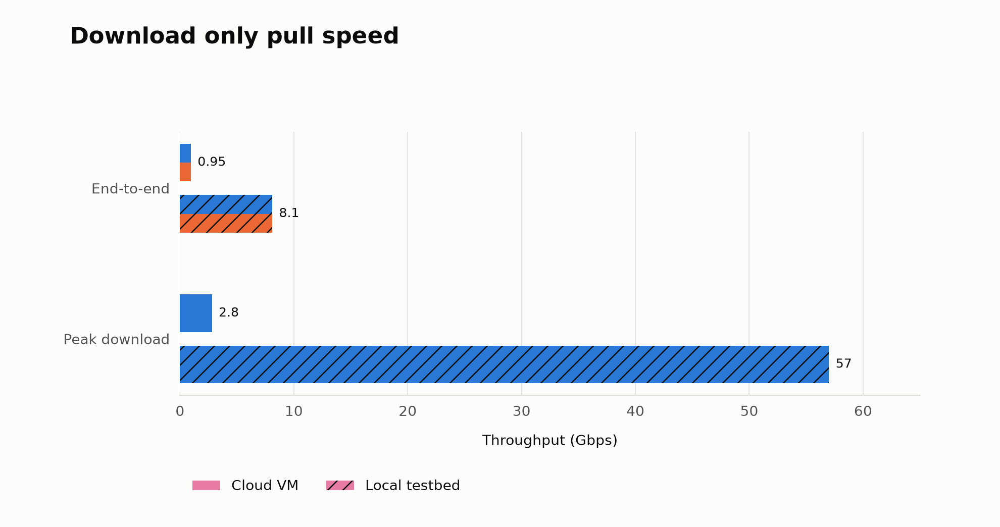

*Figure 11. End-to-end and peak throughput.*

### 5.2 A containerd bottleneck: Serialized fs-verity

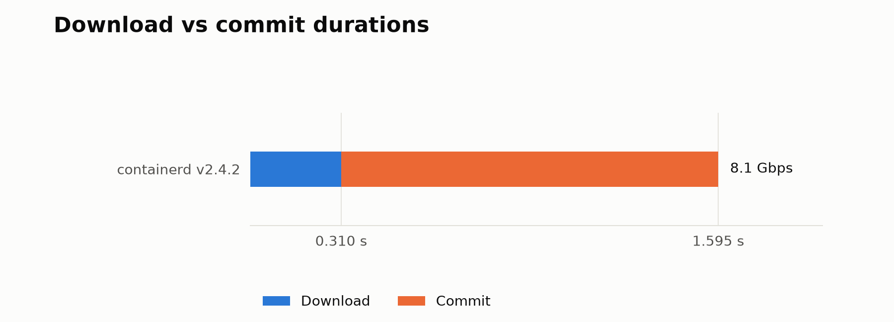

*Figure 12. Illustrative transfer and post-transfer split for containerd v2.4.2. The 0.31 s transfer and 1.595 s total duration come from separate recorded runs, not a single measured trace.*

The local path reaches a 57 Gbps peak download speed, yet its end-to-end rate remains at 8.5 Gbps, much below the disk 19.6 Gbps. This is a puzzling result. To investigate it further we use a synthetic `ctx-rand3` image that isolates this gap with three 536.9 MB layers. To understand the situation better we trace our download only pull. Results are interestingm network transfer finishes in 0.31 s, but the pull takes 1.51 s. The remaining 1.20 s falls after the bytes have arrived, directing the investigation toward content-store flushes and commits.

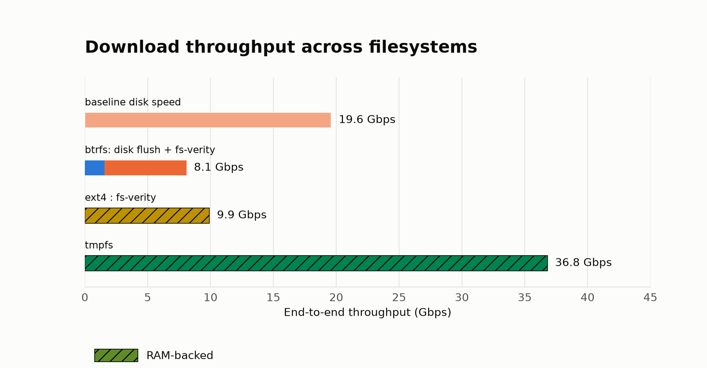

*Figure 13. End-to-end download throughput on disk, RAM-backed ext4, and tmpfs. Hatching identifies RAM-backed configurations.*

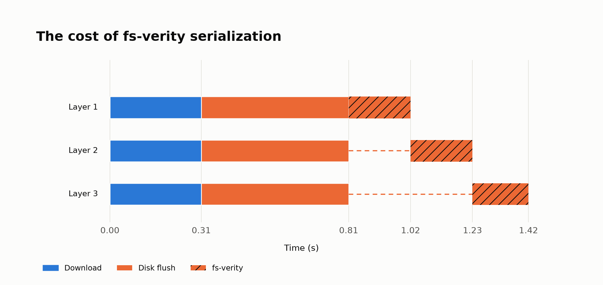

*Figure 14. Downloads and flushes overlap, while fs-verity runs sequentially across layers. Hatched orange marks fs-verity; the timeline combines transfer and fs-verity timings from separate runs, with an illustrative flush interval.*

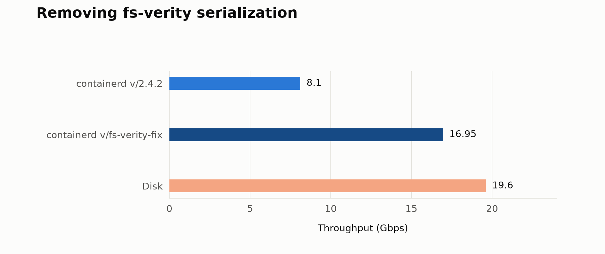

*Figure 15. End-to-end download throughput for the 1.61 GB synthetic image 12 layered version on containerd v2.4.2 vs the fs-verity fix. Download concurrency is set to 12 to maximize download speed. to The plotted observations show a 109% increase in end-to-end throughput.*

Placing ext4 on a RAM-backed loop device removes physical-device I/O while retaining a block filesystem, journaling, and fs-verity support. Download duration remains 1.30 s. Most of the delay therefore persists without physical storage.

Tracing identifies two operations between a layer's transfer and its commit. First, containerd flushes the downloaded archive with `fsync`. These flushes can overlap across layers. On disk, they make buffered writes durable; on the RAM-backed filesystem, they still exercise the filesystem's synchronization path but provide no physical persistence.

Second, containerd enables fs-verity, constructing a hash tree over the stored blob to detect changes during later reads. This rereads and hashes the blob after its download digest has already been computed. Standalone fs-verity tests on page-cached 536.9 MB files take 0.19–0.22 s on both disk-backed and RAM-backed filesystems, showing that the hashing cost persists without physical reads.

The serialization comes from where that work runs. Containerd enables fs-verity inside a write transaction on its shared metadata database, bbolt, which permits one writer at a time. Hash-tree construction therefore serializes layer commits across the daemon, including commits from unrelated images. Downloads and flushes proceed in parallel, then queue behind the shared commit gate.

To remove this commit-path bottleneck, we start another containerd instance with its content store on tmpfs. Tmpfs has no physical device to flush and does not support fs-verity, so containerd skips hash-tree construction. Download duration falls to 0.35 s, delivering 37 Gbps end to end.

We contributed a fix upstream as containerd PR #14442, *content: remove fs-verity serialization point* [13]. The patch moves expensive content preparation, including fs-verity setup, outside the metadata write transaction so that layers can perform this work concurrently. At 0.2 s per 536.9 MB layer, the serialized stage imposes a 21.5 Gbps ceiling across the daemon on this machine. Moving hash-tree construction outside the transaction removes that daemon-wide serialization; the hashing work itself remains.

### 5.3 The next bottleneck: SHA-256 verification

With the content store on tmpfs, containerd has no physical writeback or fs-verity construction to wait for, yet it remains slower than the source can deliver. Fetching the same blobs with curl and discarding the output reaches 50 Gbps with one connection at a time and 84 Gbps with three concurrent connections. Containerd reaches 15 and 37 Gbps, respectively. On tmpfs, its download duration matches the transfer window: the remaining bottleneck slows the arrival of bytes rather than adding a long delay after transfer (Table 5).

Containerd computes a SHA-256 digest of each layer's compressed blob as it receives and writes the bytes to the content store. Each write updates that layer's running digest; once all bytes have arrived, containerd compares the completed digest with the expected value in the image manifest before committing the blob. The hashing therefore runs in the download path, not as a separate pass after the layer has arrived. It is also distinct from fs-verity's later hash-tree construction, which tmpfs omits.

A CPU profile identifies this streaming verification as the dominant cost: SHA-256 accounts for 75% of containerd's sampled CPU time during the warm tmpfs download. Each layer has one digester that processes its bytes in order, using roughly one CPU core. In this configuration, that CPU-bound stream limits a layer to 15–16 Gbps. Curl performs neither the layer-digest check nor content-store writes and commits, so it provides a delivery reference rather than an equivalent pull implementation. The profile explains why removing physical storage does not close the gap: containerd still has to hash every byte, and one layer's hashing cannot use the remaining cores.

| Client and destination | Download Concurrency | Transfer time | Download duration | Mean transfer rate (Gbps) | Peak rate (Gbps) | End-to-end rate (Gbps) |
|---|---:|---:|---:|---:|---:|---:|
| curl, discard | 1 | 0.26 s | 0.26 s | 50 | 53 | 50 |
| curl, discard | 3 | 0.15 s | 0.15 s | 85 | 109 | 84 |
| containerd, tmpfs | 1 | 0.84 s | 0.84 s | 15 | 17 | 15 |
| containerd, tmpfs | 3 | 0.35 s | 0.35 s | 36 | 48 | 37 |
| containerd, tmpfs | 6 | 0.26 s | 0.26 s | 50 | 80 | 50 |

*Table 5. Download comparisons using three 536.9 MB random-data layers, except for the final row, which distributes the same data over twelve 134.2 MB layers. Registry blobs are page-cached. Transfer rates cover the active receive window; end-to-end rates include the full command duration. Peak rates use 50 ms samples. These short, single-run measurements establish the scale of the differences rather than precise rankings among nearby rates. The disk's measured sequential write rate is 19.6 Gbps.*

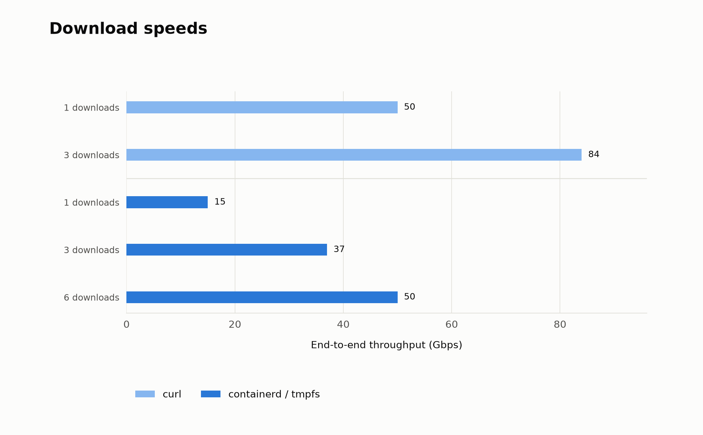

*Figure 16. End-to-end download throughput from the fast source. Tmpfs removes physical writeback and fs-verity construction, the next bottleneck is SHA-256 verification which is CPU-bound. Curl discards the received bytes without layer verification or content-store operations.*

| Scope | Download bottleneck | Throughput (Gbps) |
|---|---|---:|
| Per stream | HTTP | 50 |
| Per stream | SHA-256 | 15 |
| Per stream | fs-verity | 20 |
| Per stream | SHA-256 + fs-verity | 8.6 |

*Table 6. Download bottlenecks and their scope on the local testbed. The HTTP rate describes this source and connection; the daemon-wide fs-verity limit is shared across image pulls.*

More connections within a layer do not remove this hashing limit. Parallel range requests can fetch chunks concurrently, but the implementation feeds those chunks into the same per-layer digester in order. Downloading different layers does expose CPU parallelism because each layer has its own digester. Three concurrent layers raise the tmpfs rate from 15 to 37 Gbps. Distributing the same data over twelve 134.2 MB layers and allowing six concurrent downloads raises it further to 50 Gbps, with an 80 Gbps peak. The gain is consistent with more independent hashing streams using more cores; it does not make any one layer's digest computation parallel.

The measured limits have different scopes (Table 6). Delivery constrains each connection; streaming verification constrains each layer; unpatched fs-verity construction constrains the entire daemon. The rates are specific to the M4 Pro testbed, expected to change with differing hardware. This matters much more on data center machines as network bandwidth cannot be utilized effectively due to verification and fs-verity bottlenecks. The next section brings the download and unpack findings together to summarize the full-pull improvements.

## 6. Removing one bottleneck at a time

Each step removes a different cost. Faster storage and network improve on the cloud baseline. Zstd reduces decompression work, and parallel unpack overlaps layer extraction. EROFS avoids eager layer extraction altogether and eliminates disk and CPU work during unpack.

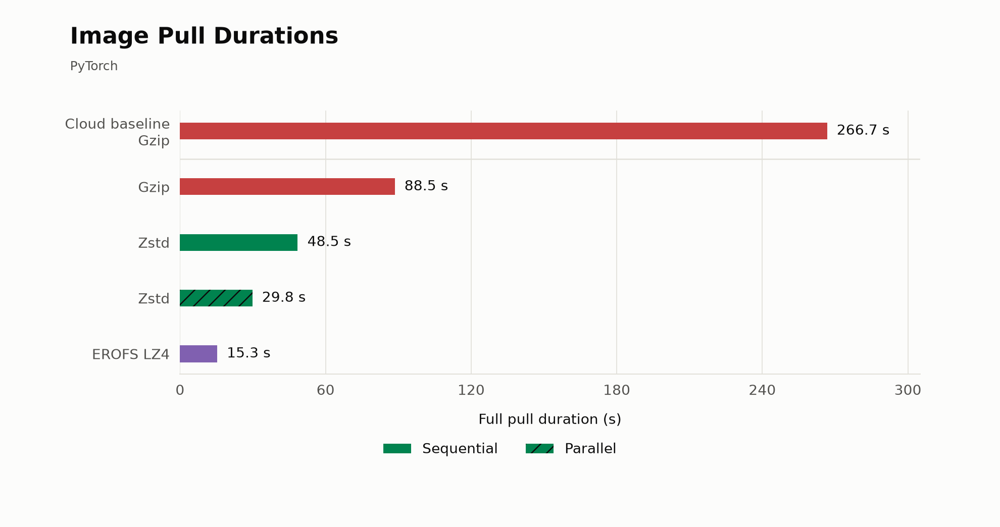

*Figure 17. Final image pull durations.*

| Configuration | Pull duration | Speedup over cloud baseline | Speedup over local baseline |
|---|---:|---:|---:|
| Cloud VM, slow disk and network - gzip, sequential unpack | 266.7 s | 1.00× | n/a |
| Local testbed, fast disk and network - gzip, sequential unpack | 88.5 s | 3.01× | 1.00× |
| Local testbed, fast disk and network - zstd, sequential unpack | 48.5 s | 5.50× | 1.82× |
| Local testbed, fast disk and network - zstd, parallel unpack | 29.8 s | 8.95× | 2.97× |
| Local testbed, fast disk and network - EROFS LZ4, sequential unpack | 15.3 s | 17.43× | 5.78× |

*Table 7. Final image pull durations.*

## 7. Conclusion

A large image must become a usable filesystem before an eager-pull workload can start. In our experiments, that work continues long after network transfer ends. Baseline cloud storage absorbs about 2.8 bytes of writes for each compressed image byte, while a faster node exposes decompression and extraction scheduling as the larger costs. The progression from a regular cloud VM to faster infrastructure, zstd, and parallel unpacking reduces a PyTorch pull from 266.7 to 29.8 s, an 8.95× improvement. On the faster machine alone, the codec and scheduling changes reduce 88.5 to 29.8 s, or 2.97×. Native EROFS layers avoid eager tar extraction and reduce the pull to 15.3 s, a 17.43× improvement over the cloud baseline and 5.78× over local gzip.

The runtime's internal concurrency becomes important once external bottlenecks are removed. Removing fs-verity serialization shortens download durations, while ordered verification and extraction still limit each layer's parallelism. Spreading extraction over enough layers reaches 110 Gbps in the in-memory unpack experiment; the PyTorch image concentrates most work in three layers. Faster image pulls require both high-bandwidth delivery and a runtime path that can turn the incoming bytes into files without serializing the available work.

## References

[1] Tyler Harter, Brandon Salmon, Rose Liu, Andrea C. Arpaci-Dusseau, and Remzi H. Arpaci-Dusseau. *Slacker: Fast Distribution with Lazy Docker Containers.* USENIX FAST, 2016, pp. 181–195. https://www.usenix.org/conference/fast16/technical-sessions/presentation/harter

[2] Huiba Li, Yifan Yuan, Rui Du, Kai Ma, Lanzheng Liu, and Windsor Hsu. *DADI: Block-Level Image Service for Agile and Elastic Application Deployment.* USENIX ATC, 2020, pp. 727–740. https://www.usenix.org/conference/atc20/presentation/li-huiba

[3] Spegel contributors. *Spegel: Stateless cluster-local OCI registry mirror.* Project repository. https://github.com/spegel-org/spegel

[4] OpenAI. *Scaling Kubernetes to 2,500 nodes.* January 18, 2018. https://openai.com/index/scaling-kubernetes-to-2500-nodes/

[5] DeepSeek-AI. *DeepSeek Elastic Compute (DSec): A Sandbox Infrastructure for Effective Agentic Training at Scale.* Technical report, arXiv:2609.22978, 2026. https://arxiv.org/abs/2609.22978

[6] NVIDIA. *NVIDIA DGX B300 User Guide*, Feature Summary. https://docs.nvidia.com/dgx/dgxb300-user-guide/dgxb300-user-guide.pdf. Hardware specifications and separately labeled disk-throughput estimates are recorded in `../docs/b300-host-specs.md`.

[7] Kubernetes contributors. *Images: Serial and parallel image pulls.* https://kubernetes.io/docs/concepts/containers/images/#serial-and-parallel-image-pulls

[8] Kubeflow contributors. *Kubeflow Trainer: Overview.* https://www.kubeflow.org/docs/components/trainer/overview/

[9] Kubeflow contributors. *Kubeflow Pipelines: Overview.* https://www.kubeflow.org/docs/components/pipelines/overview/

[10] KServe contributors. *Autoscaling with Knative Pod Autoscaler.* https://kserve.github.io/website/docs/model-serving/predictive-inference/autoscaling/kpa-autoscaler

[11] Rui Li et al. *BootSeer: Analyzing and Mitigating Initialization Bottlenecks in Large-Scale LLM Training.* arXiv:2507.12619v2, January 27, 2026. https://arxiv.org/abs/2507.12619

[12] Amazon Web Services. *Amazon ECR interface VPC endpoints: Create the Amazon S3 gateway endpoint.* https://docs.aws.amazon.com/AmazonECR/latest/userguide/vpc-endpoints.html

[13] containerd contributors. *content: remove fs-verity serialization point.* Pull request #14442. https://github.com/containerd/containerd/pull/14442
